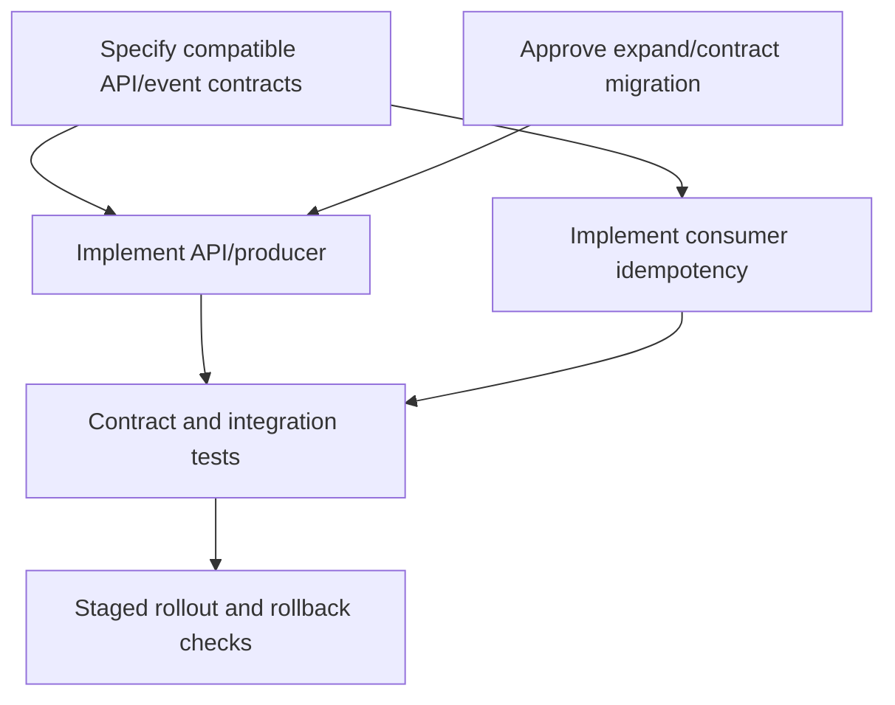

# Fictional example: Add an operation across .NET services

This example deliberately has no real repository evidence.

Goal: An API accepts a new operation, service A persists it, and service B consumes the resulting event. Legacy clients must continue working.

Hard constraints:
- H1: Old clients remain compatible.
- H2: New event handling is idempotent.
- H3: Database changes deploy without downtime.
- H4: Rollback does not require immediate data loss.

Decisions:
- X1: API contract evolution.
- X2: Persistence migration approach.
- X3: Event format/version.
- X4: Consumer deduplication state.
- X5: Rollout order.

Coupling:
- H1 links X1 and X3.
- H3 links X2 and X5.
- H2 links X3 and X4.
- H4 links X2 and X5.

Partition: {X1,X3} contract group; {X2,X5} migration group; {X3,X4} event-consumption group. X3 is deliberately shared: event contract is a separator, not an error.

Task DAG:

Correctness notes: `T2` can proceed alongside `T1` only while their overlapping assumptions are explicitly tracked; the implementation must honor both. The graph is illustrative, not an optimal tree decomposition.
