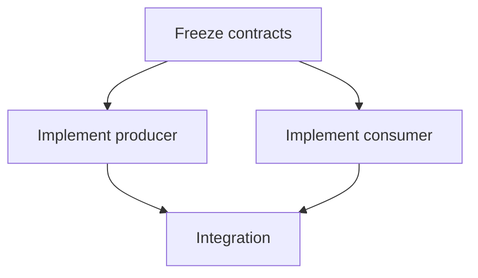

# Plan: <id> (v1)

## Goal / out-of-scope / definition of done
<Keep observable and testable.>

## Evidence
Observed with paths/symbols | Inferred | Unknown. Never disguise inferred repo knowledge as observed.

## Constraints and decision graph
Reference `constraints.md`, which should record constraint IDs, hard/soft, affected decision variables, evidence and test. Briefly summarize clusters and shared separators here.

## Partition comparison
| Candidate | Max coupled cluster | Cross-cluster constraints | Verification + coordination costs | Decision |
|---|---|---|---|---|

## Phase graph

Replace example graph with grounded phases. Enumerate safe execution waves and critical path if known.

## Phase inventory
| Phase | Prerequisites | Deliverable | Write boundary | Acceptance gate | Prompt path |
|---|---|---|---|---|---|

## Coverage matrix
| Acceptance criterion / hard constraint | Phase owner | Verification gate |
|---|---|---|

## Risk, rollout / rollback, replan triggers
<Explicit unknowns, integration constraints and frozen contract change triggers.>

Planning only: no implementation performed.
